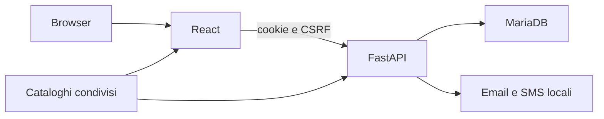

# Equia

Gestionale derivato da Università ERSAF. Base sorgente: `e2401a006c6dde7ab6320433ba8c25baacf019fd`.
Repository autonomo, database nuovo, nessuna importazione di dati del gestionale di origine.

## Perimetro

Dashboard vuota, attuatori, sottoscrittori, centri, notizie ed EduNews.
Accesso, recupero password, sessioni, verifica contatti e secondo fattore riutilizzano
i flussi del gestionale di origine. Creazione account interna: nessuna iscrizione pubblica.
Nazionale conserva il secondo fattore obbligatorio; gli altri ruoli accedono con password.

La prima base rende utilizzabili accesso, profilo e sicurezza; predispone la navigazione
delle anagrafiche e conserva EduNews. Il completamento di elenchi e schede anagrafiche
è la successiva tranche di Matteo. Notizie è una sezione distinta da EduNews, da definire
e completare con Vincenzo.

## Struttura

| Percorso | Responsabilità |
|---|---|
| `shared/ruoli.json` | Identità dei quattro ruoli, assegnazioni e visibilità del menu |
| `shared/identita.json` | Nome, versione e firma |
| `backend/src/main.py` | Bootstrap FastAPI |
| `backend/src/auth`, `security`, `mfa`, `otp` | Cookie, CSRF, password, OTP, authenticator e passkey |
| `backend/src/account` | Funzioni comuni del ciclo account |
| `backend/src/clienti`, `utenti`, `aziende`, `ruolo` | Modelli anagrafici comuni |
| `backend/src/edunews24`, `profilo`, `notifiche` | Informazione, profilo e invio messaggi |
| `backend/src/notizie`, `frontend/src/components/notizie` | Ingressi collegati per la tranche Notizie, ancora da implementare |
| `frontend/src/App.jsx` | Composizione delle rotte |
| `frontend/src/config` | URL, icone, testi, tema, token e stili |
| `frontend/src/components`, `hooks`, `lib` | UI, coordinamento e trasporto API |
| `db/migrations` | Schema iniziale e migrazioni conservate per l'accesso |
| `scripts`, `compose.yml` | Ambiente locale e verifiche |
| `deploy/staging.json`, `deploy/remote`, `scripts/deploy.ps1` | Contratto centrale e rilascio dello staging dedicato |

## Vincoli

- Unica sorgente dei ruoli nei cataloghi condivisi; controlli API obbligatori.
- Identificativi utente e cliente distinti.
- Sottoscrittore è un tipo di anagrafica; non introduce un quinto ruolo di accesso.
- Tema e icone centralizzati; niente copie locali dei controlli comuni.
- Dataset locali sintetici; email e SMS su file, nessun invio reale nelle verifiche.
- Nessun modulo pratiche, pagamenti, ricevute, formazione, chat o accesso Universo.
- Staging dedicato: database, reti, segreti e release indipendenti; procedura in [deploy.md](deploy.md).

Comandi e stato delle verifiche in [development.md](development.md);
responsabilità in [collaborazione.md](collaborazione.md).
